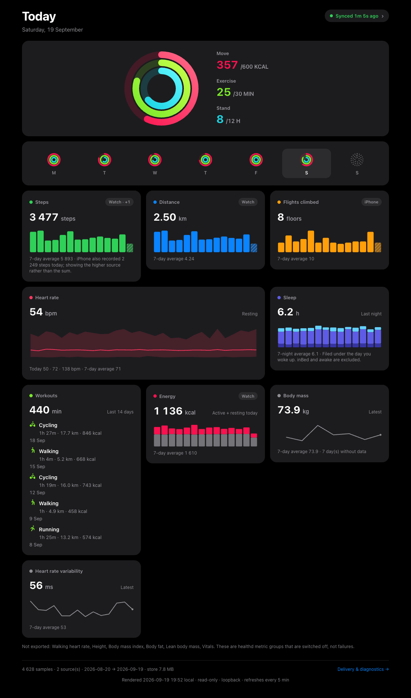

# vitals

**What it is.** A self-hosted receiver for Apple Health exports. An iPhone app
POSTs batches of HealthKit samples to a port on your LAN; vitals stores them in
SQLite outside the repo and serves a loopback dashboard — activity rings, the
week, metric cards — plus an ops page that says whether the pipe is alive.

**What it needs.** Node 22 (`better-sqlite3` is built against its ABI). The
always-on service is a macOS LaunchAgent; the suite also runs on Linux in CI.
The sender is the healthd iOS app (not yet public) — or anything that speaks
the contract vendored in [`docs/payload.md`](docs/payload.md).

**Try it with no phone.** Synthetic data, a throwaway store, Ctrl-C to stop:

    npm ci && npm run demo    # then open http://127.0.0.1:4790/

---

The rest of this document is written to the same standard as the payload
contract: enough to reimplement or operate the endpoint without reading the
source. It is a monitor with a store attached, not an analytics product.

---

## The one rule

**healthd never reads our response body, and it never retries a 4xx we send.** One
request at a time, a 60s timeout on a batch's first attempt (15s on a retry),
redirects refused, any 2xx is success. What happens after a failure depends
only on the status we sent ([`docs/payload.md`](docs/payload.md), *The caveat
that matters*):

- no answer, `408`, `425`, `429`, any `5xx`, or a `413` carrying `Retry-After`:
  the phone keeps the batch's bytes in an on-device outbox and retries them
  under the same `exportId` and `batchSequence`, backing off from 15 minutes to
  an hour, for up to seven days;
- `400`, `401`, `403`, `404`, `405`, `422`, any `3xx`, a bare `413`, or anything
  else: the batch is dropped the moment we answer, and nothing on the phone
  tries it again.

So a 4xx from us is not a complaint. It is permanent data loss.

Everything below follows from that sentence:

1. **2xx for anything we can persist** — including bytes we cannot parse and a
   `schemaVersion` we do not know. Those go to the `quarantine` table verbatim
   and are answered `200`. Answering `400` on an unrecognised shape would be a
   principled way to throw health data in the bin.
2. **Non-2xx only for the two configuration errors the owner must see:** `401`
   (credential) and `413` (body over the cap). Neither is recoverable by being
   polite about it, and both are the owner's to fix.
3. **Our own observability is the product.** The sender is blind to our body, so
   everything we learn about a delivery goes into a table, not into a response.
   That is what the dashboard reads.

If you are changing a status code in `src/ingest.ts`, meet rule 1 first. A new
4xx anywhere on the ingest path (anything but `408`, `425`, `429` or a `413`
with `Retry-After`) silently deletes health data that will never be sent again.
A `5xx` is retried, which does not make it a free tool — see Open decisions.

---

## The two listeners, and why they are separate

| | ingest | read |
|---|---|---|
| bind | `0.0.0.0:4781` — LAN | `127.0.0.1:4780` — loopback |
| methods | `POST` only (everything else 404) | `GET`/`HEAD` only (everything else 405), plus `POST /api/restart` |
| auth | the phone's credential header | none of its own |
| who talks to it | **the phone, directly** | the browser on the Mac; optionally the LAN through a portal |
| proxied by a portal | **never** | optional — e.g. `:7778`, behind the portal's basic auth |

One process, two Fastify instances, one store.

"The portal" below is an optional LAN reverse proxy with its own login. The
author runs Synapse, a private portal that is not part of this repo; any proxy
that can allowlist GET routes plays the same role, and vitals needs none.

They are split because the two credentials must not meet. The portal password
can never be replayed into the ingest path, because nothing the portal can reach
points at 4781 — vitals' portal registry entry names only `127.0.0.1:4780`, with
`defaultAction: "deny"` and a four-route GET allowlist (`/`, `/assets/…`,
`/healthz`, `/api/summary`; `/pipe` and `/api/fitness` are not on it). And the
phone's token can
never read the data back, because the read listener does not receive the token
source as a dependency at all: it cannot leak what it never holds.

**Ingest is never proxied.** If you ever find yourself adding a route to the
portal entry that reaches 4781, that is the moment both separations stop being
true.

---

## Setting up the phone

In healthd, on the phone, set the destination to one of these:

```
http://<lan-ip>:4781/ingest          # the Mac's LAN address today
http://<bonjour-name>:4781/ingest    # the same machine, by name
```

Prefer the second one. A LAN address is usually a DHCP lease: the router can
hand the Mac a different one after a reboot or a lease expiry, and when it
does, the phone keeps POSTing into an address that now belongs to something else
— or to nothing — and healthd can tell you exports are failing, not that the
address moved, because from its side a failed export is just a failed export.
`<bonjour-name>` is the Mac's Bonjour name, shown as *Local hostname* in System
Settings → General → Sharing (`scutil --get LocalHostName` prints its first
label). macOS advertises it itself and re-advertises it with whatever address
the machine currently holds. It survives the lease change; the literal IP does
not.

It is advertised by macOS, not by anything in this project or in a portal — so
it also survives the portal being down. (If a portal advertises names of its
own, those describe the portal, not this endpoint. Do not point the phone at
them.)

Then the credential, in healthd's own header field:

```
header name:   x-vitals-token
header value:  the contents of the file below, pasted exactly
```

```
~/Library/Application Support/vitals/token
```

Read it with `cat "$HOME/Library/Application Support/vitals/token"` and type it
into the phone. The file is mode `600`, minted by `npm run token:mint`, and its
value appears nowhere else: not in this repo, not in a commit, not in a log line,
not in any response body. Rotating it means re-minting and re-typing it on the
phone — `npm run token:mint -- --force`, because without `--force` it refuses
to overwrite an existing credential. The server picks up the new value without
a restart (it re-reads the file when the mtime changes).

The header name is configurable — `VITALS_TOKEN_HEADER`, compared
case-insensitively — but it must match what is typed in the app. The comparison
of the value is constant-time over SHA-256 digests, so neither the value nor its
length is measurable by timing.

Finally, tap **Save & Test Connection** on healthd's destination screen. That
sends the connectivity probe:
the same envelope, empty, `connectivityTest: true`. We answer `200`, record a
delivery row and store no samples — and a status tile reading `/healthz` goes from
`NOTHING EVER` to green within one poll. That is the whole install, verified
from the device that will actually be sending.

---

## The response contract

Every response the ingest listener can produce. This is the operator-facing
contract: healthd keeps at most the status code and never reads the body, so
this table is for you, reading the delivery log, not for the phone.

### Ingest — `POST http://<host>:4781/ingest`

| status | body | when | what it means |
|---|---|---|---|
| `200` | `{"ok":true,"probe":true}` | `connectivityTest: true` with no samples | Test connection worked. One delivery row, outcome `probe`, nothing stored. |
| `200` | `{"ok":true,"stored":N,"duplicates":D,"quarantined":0}` | a valid batch | `stored` is newly inserted rows from this request. `duplicates` are valid samples already present by `uuid`, plus HeartRate samples already present by `content_id`. |
| `200` | `{"ok":true,"stored":N,"duplicates":D,"quarantined":1}` | a valid batch carrying some malformed samples | The good new samples are stored, duplicates are counted, and malformed samples are kept verbatim in `quarantine` with the reason. One bad sample never costs the 999 good ones beside it. |
| `200` | `{"ok":true,"stored":0,"quarantined":1}` | body is not JSON, or `schemaVersion` is not 1, or the envelope does not match | The raw bytes are kept in `quarantine`, headers minus the credential, with a reason (`unparseable-json`, `unknown-schema-version`, `bad-envelope`). Deliberately not a 4xx: see The one rule. `quarantined24h` on `/healthz` is how you find out. |
| `401` | `{"ok":false,"error":"unauthorised"}` | credential header missing or wrong | The only non-2xx the phone will realistically hit. Logged with the remote address; counted as `unauthorised24h` and shown on the tile as `N refused 24h`. **This data is gone**: healthd drops a batch answered `401` and never retries it — fix the header in the app and re-export. |
| `413` | `{"ok":false,"error":"payload too large"}` | body over `VITALS_MAX_BODY_BYTES` (2 MB) | Should not happen: healthd caps a batch at 1000 samples and under 1 MB. If it fires, raise the cap rather than shrug — vitals sends no `Retry-After` with it, so healthd treats it as permanent and the batch is lost. |
| `404` | `{"ok":false,"error":"this port accepts POST only","endpoint":"/ingest"}` | any non-POST | You, with a browser. This port has no dashboard, no `/healthz`, nothing to read. Logged with outcome `unroutable`. |
| `500` | `{"ok":false,"error":"internal error"}` | an unexpected failure | A bug. Unlike every `200` above, **the body is not kept** — only the delivery row is. healthd retries a `5xx` with backoff for up to seven days, so the same bytes may arrive again under the same `exportId` and `batchSequence`; if the retry hits the same bug, or the seven days run out, the batch is gone. Treat it as a defect, not as weather. |

**A POST to the wrong path is still accepted.** `/ingest` is canonical, but any
path is routed to the same handler and the path actually used is recorded on the
delivery row (`non-canonical path /whatever`). A typo in the endpoint typed on a
phone keyboard must not cost an export; it should be visible instead, and it is.

### What lands in the store

- **Deduplication is on `uuid`, insert-once.** A repeated sample does not rewrite
  `export_id` or `received_at`; those fields describe when this receiver first
  stored that row. The duplicate request is counted on its delivery row instead.
- **HeartRate also deduplicates on `content_id`.** healthd (via HealthKit) has been
  observed re-minting `uuid` for identical HeartRate content, producing about
  12 stored rows per real reading. For HeartRate only, `content_id` is unique and
  repeated content becomes `duplicates`. Other types are not deduped this way:
  `id` collides by design for them (720 real samples carried 195 distinct ids).
- **A run is one `exportId`.** Batches carry `batchSequence` from 1 and
  `isFinalBatch` on the last. A run that stops without its final batch, and then
  goes quiet for `VITALS_TRUNCATED_AFTER_MINUTES` (60), is **truncated**: the
  partial is kept, counted, surfaced on the page and on the tile, and never
  deleted. Truncated is not invalid.
- **A truncated run can still complete.** healthd retries a failed batch for
  up to seven days under the same `exportId` and `batchSequence`, and every
  batch that lands recomputes its run from the `batches` table — so a run that
  was truncated stops being truncated the moment its missing batches arrive.
- **The sender's occasion is stored, and `/pipe` reads it.** healthd
  publishes `basis` (`window` or `anchor`), `occasionStart` and `occasionEnd`
  alongside the window. All three are accepted, normalised to UTC and kept on
  the run's row; all three are nullable, because a healthd older than the
  change sends none of them and an absent field is stored as `NULL` rather than
  guessed. The runs list on `/pipe` shows a run's occasion as its span, and
  falls back to the run's window for a run first seen without one; the drift
  check below compares the occasion. `basis` is kept but nothing reads it yet.
  An unrecognised `basis` value is stored verbatim, never rejected: binning
  real samples over one metadata word we do not read would be the same bad
  trade the quarantine rule already refuses.
- **Run-metadata drift** — a later batch of the same `exportId` claiming a
  different `generatedAt`, or a different occasion when both the run and the
  batch carry one — is noted on the delivery, the run keeps the values of the
  batch that opened it, and the samples are stored normally. The window is
  never compared: on `basis: "anchor"` it is each batch's own bracket by
  design, so the run's `window_start`/`window_end` hold its extent — the
  earliest start and the latest end over its batches, order-free and unmoved
  by a replay. Until slice 6 the check compared the window instead; measured
  then on a two-batch anchored run, that displayed a 1-hour window for a run
  truly spanning 190 hours and put one false drift note on the second batch.
  Storing the occasion before anything read it is what made the fix possible.

### Read — `http://127.0.0.1:4780` (and, for the allowlisted routes, `:7778` through the portal)

| route | status | notes |
|---|---|---|
| `GET /` | `200` | The fitness page: today's rings, the week, the metric cards. See [The dashboard](#the-dashboard). |
| `GET /pipe` | `200` | Delivery health: the log, the runs, per-type freshness, quarantine. The ops page; a run's span is its occasion when it carries one. |
| `GET /healthz` | `200` / `503` | `503` when the store will not take the probe row — the one read route that writes, which is how `dbWritable` is proved rather than assumed. `startedAt` is when this process started (ISO, UTC) — the same instant as the one `vitals: started <ISO> commit <rev>` line it logs at startup — so a day with no deliveries reads as a receiver gap (started after it) or a phone gap (up throughout). `sha` is the full commit this process is running (40 hex), resolved once at start and held, so it does not move when the checkout does; `null` if it could not be resolved (one `WARNING` line in the log). `<rev>` in the startup line is its first 12 characters. `sha` is the one key added since the tile was built; the tile does not read it. |
| `GET /api/summary` | `200` | The entire `/pipe` model as JSON — same numbers, same code path, so the page and anything reading it cannot drift. |
| `GET /api/fitness` | `200` | The same, for `/`. |
| `GET /assets/app.css` | `200` | The fitness stylesheet. |
| `GET /assets/pipe.css` | `200` | The ops stylesheet. |
| `POST /api/restart` | `200` / `409` / `4xx` | Restarts the daemon: `200 {"restarting":true,"exit_code":75}`, then the same stop as `SIGTERM` and exit 75, and launchd's `KeepAlive` starts the code now on disk. Only when the read listener is bound to loopback (otherwise `404`). Refused, with nothing armed, `{"error":"restart_refused","field":…}`: `403` unless there is exactly one `Host` of `127.0.0.1:<port>`/`localhost:<port>`, `403` on any `Origin` or a `Sec-Fetch-Site` other than `none`, `415` unless `Content-Type: application/json`, `413` over 1024 bytes, `400` unless the body is a JSON object whose only member is an optional boolean `force`. `409 {"error":"ingest in progress","inFlight":n}` while the phone is mid-delivery; `{"force":true}` overrides that, with a `WARNING` line; the forced stop is bounded by the drain cap (`VITALS_DRAIN_CAP_SECONDS`, 10 s). See [Restart / deploy](#restart--deploy-nyx-path). Never proxied: the portal entry is a GET allowlist. |
| anything else not `GET`/`HEAD` | `405` | `Allow: GET, HEAD`, refused before routing, so a route added later cannot quietly become writable. |
| any other path | `404` | Body lists the routes above. |

---

## Operating it

### Install

```bash
cd vitals
npm install
npm run token:mint        # writes ~/Library/Application Support/vitals/token, mode 600
npm run service:install   # installs and starts the LaunchAgent, then verifies it
```

The service scripts (`service:install`, `service:uninstall`, `service:verify`)
need launchagent-kit, a separate tool whose `lak` command renders, lints,
loads, unloads and checks the LaunchAgent; vitals no longer calls `launchctl`
itself. launchagent-kit is **not published** at the moment. `lak` is found by
one rule, shared by all three scripts (`scripts/_lak.sh`): `$LAK` if set and
non-empty, else `lak` on `PATH` — there is no default location. If neither
gives an executable file the script stops with one line naming `LAK` and
`PATH`, before it touches anything.

Without launchagent-kit, skip `npm run service:install` and run the daemon
yourself — see [Running it in the foreground](#running-it-in-the-foreground)
(`npm start`). Nothing restarts it for you then: no launchd job, no
`KeepAlive`, and `npm run restart` / `POST /api/restart` assume the LaunchAgent.

`service:install` is idempotent and refuses to install something broken: it picks
node >= 22 deliberately (`better-sqlite3` is compiled against that ABI) and
**proves the choice by loading the native module with the exact binary it is about
to write into the plist**, and refuses to continue without a credential file. A
reinstall then **renders and lints the new plist before stopping the running
job** (`lak render` into a temp file, `lak lint`): a template that will not
render leaves the working service running. Only then does it unload the existing
job (`lak uninstall`) before sweeping the ports (the other order hands the port
straight back to the copy `KeepAlive` respawns), load the new plist
(`lak install`; `RunAtLoad` starts it), and end by running the verifier.

Run it from a normal login shell; some sandboxes and agent runtimes refuse to
register a persistent job from inside their own process, and that guard is
correct. It picks the first node >= 22 among Homebrew's `node@22`, Homebrew's
`node` and `PATH`; set `VITALS_NODE=/path/to/node` to choose explicitly, and
`bash scripts/service-install.sh --print-node` to see the choice without
installing anything.

### Verify

```bash
npm run service:verify
```

It proves *serving*, not *loading*: exactly one server process matched by program
path, the store path the running process actually opened cross-checked against
the file on disk, the read port loopback-only, the ingest port LAN-facing, and
both boundaries **fired at** rather than asserted — `POST` on the read port → 405,
`GET /` on ingest → 404, unauthenticated `POST /ingest` → 401.

That last check leaves a genuine `401` row in the delivery log and bumps
*unauthorised 24h* on the page and the tile, every run. Deliberate: a boundary
nobody ever fired at is a claim, and the alternative — a verification script
issuing `DELETE`s against your health data — is worse. The script says so in its
own output, and the rows age out of the 24h counter by themselves.

### Logs

```bash
npm run service:logs                            # tail -f the daemon log
tail -n 50 ~/Library/Logs/vitals/vitals.log     # one line per POST
wc -c < ~/Library/Logs/vitals/vitals.err.log    # should be 0
```

One line per POST, including the refused ones (a non-POST answered `404` gets a
delivery row but no log line):

```
2026-09-19T10:38:41.995Z 401 unauthorised bytes=265 from=192.0.2.20
2026-09-19T10:38:42.011Z 200 probe bytes=265 from=192.0.2.20
2026-09-19T10:37:38.549Z 200 export export=6C7F1E22-… seq=1 final=true samples=3 stored=3 duplicates=0 rejected=0 bytes=1363
```

The credential never appears in these lines. **The error log being empty means
something** — the service was built with no permanent stderr noise precisely so
that a non-empty `vitals.err.log` is a signal rather than scenery.

### The store

```
~/Library/Application Support/vitals/vitals.db     (+ -wal, -shm)
```

Outside both git repos, deliberately and permanently: health data does not enter
anything that gets pushed. Override with `VITALS_DB` if you must, but one daemon,
one owner, one store — a second path buys you two half-series nobody can compare.

Tables: `samples` (`uuid` PK; HeartRate also unique on `content_id`), `runs` (one row per `exportId`), `batches`,
`deliveries` (every request that reached us, including the refused ones — this is
the table that makes silence visible), `quarantine` (raw bodies we could not
read), `meta`.

Back it up **without stopping the service** — `.backup` is safe against a live
WAL database:

```bash
sqlite3 ~/Library/Application\ Support/vitals/vitals.db \
  ".backup '/tmp/vitals-$(date +%F).db'"
sqlite3 /tmp/vitals-$(date +%F).db "pragma integrity_check;"   # -> ok
```

Copying the three files with `cp` while the daemon is running is not equivalent
and can produce a torn backup. Use `.backup`.

`dbBytes` on `/healthz` and the *store* line on the tile count `.db` + `-wal` + `-shm`
together, so the number moves with WAL activity and drops after a clean restart
checkpoints the journal. That is the file footprint, not the data volume; for
data, read `samplesTotal`.

### Stop, start, restart

```bash
npm run restart                                          # kickstart -k; measured ~6s to serving again (Sept 2026)
launchctl list local.vitals.daemon                       # PID and LastExitStatus
launchctl bootout gui/$(id -u)/local.vitals.daemon       # stop (KeepAlive will NOT bring it back)
launchctl bootstrap gui/$(id -u) ~/Library/LaunchAgents/local.vitals.daemon.plist   # start again
npm run service:uninstall                                # remove it entirely
```

`KeepAlive` is on, so a crash comes back by itself (measured in September 2026: `kill -9` → serving
again in ~6.7s with the delivery log intact and the WAL recovered). `bootout` is
how you stop it on purpose. `SIGTERM` is handled: both listeners close, the WAL is
checkpointed, the store is closed, exit 0. `POST /api/restart` runs the same stop
and exits 75 instead (below).

The stop waits at most `VITALS_DRAIN_CAP_SECONDS` (10) for requests in flight;
a request that finishes inside it is stored and answered, and its connection
is closed after the reply. When the cap is reached, every connection still open
is closed, one `WARNING drain cap …` line says how many, and the stop finishes
as usual — still exit 0 for a signal, 75 for a restart. An upload cut there was
never stored (its body had not arrived), and healthd sends it again after its
backoff.

This is a **login-scoped user agent**. Reboot survival has been observed once,
not tested: after a reboot on 2026-10-03 the job was serving 39 seconds after
boot, and `launchctl print` still reported `runs = 1`. One observation is not a
guarantee.

### Restart / deploy (Nyx path)

The daemon runs from this checkout, so a deploy is: pull, install only if the
lockfile moved, ask the running process to restart, and wait until `/healthz`
reports the commit you pulled. No `launchctl`, no plist.

```bash
C=<checkout>                                             # the directory the LaunchAgent runs from
before=$(git -C "$C" rev-parse HEAD)
git -C "$C" pull --ff-only
# Dependencies only when package-lock.json changed, with the daemon's node 22 on
# PATH (better-sqlite3 is a native module built for that node):
git -C "$C" diff --quiet "$before" HEAD -- package-lock.json || (cd "$C" && npm ci)

curl -sS -X POST -H 'Content-Type: application/json' -d '{}' http://127.0.0.1:4780/api/restart
# -> {"restarting":true,"exit_code":75}

want=$(git -C "$C" rev-parse HEAD)
for i in $(seq 60); do                                   # poll /healthz until sha is the pulled HEAD
  curl -s http://127.0.0.1:4780/healthz | grep -q "\"sha\":\"$want\"" && { echo "running $want"; break; }
  sleep 2
done
```

- `409 {"error":"ingest in progress",…}` means the phone is mid-delivery: wait a
  few seconds and send it again. `{"force":true}` restarts anyway (the stop
  still lets the request in progress finish, for at most the drain cap, then
  cuts it); it is for when you know why.
- launchd relaunches at most once per `ThrottleInterval` (30 s) after the last
  launch, so a restart within 30 s of the previous one takes up to that long.
- `sha` stays `null` if the process cannot resolve its commit (no git, not a
  checkout); then confirm the restart by `startedAt` changing instead.
- `npm run restart` (`launchctl kickstart -k`) is the manual way and is not the
  Nyx path.

**The first deploy of this route needs one manual restart** (`npm run restart`):
the process running before it has no `/api/restart` to call.

### Running it in the foreground

```bash
export PATH=/opt/homebrew/opt/node@22/bin:$PATH   # node 22 is required
npm start        # or: npm run dev   (watch mode)
npm test
npm run typecheck
```

Stop the LaunchAgent first, or pick other ports — two copies fighting over one
port reads like "vitals is broken" rather than "there are two of you". `npm start`
prints `.env not found. Continuing without it.` when there is no `.env`; that is
the loader, not a problem. The daemon does not carry that flag at all.

### Configuration

Every value has a working default; `.env` (for `npm start`) and the plist's
`EnvironmentVariables` (for the daemon) exist to override, not to be required.
See `.env.example`. A mistyped port fails at startup on purpose — a silent
non-delivery later is the exact failure this project exists to make visible.

| variable | default |
|---|---|
| `VITALS_STATE_DIR` | `~/Library/Application Support/vitals` |
| `VITALS_DB` | `<state dir>/vitals.db` |
| `VITALS_TOKEN_FILE` | `<state dir>/token` |
| `VITALS_TOKEN_HEADER` | `x-vitals-token` |
| `VITALS_INGEST_HOST` / `_PORT` | `0.0.0.0` / `4781` |
| `VITALS_READ_HOST` / `_PORT` | `127.0.0.1` / `4780` |
| `VITALS_MAX_BODY_BYTES` | `2000000` |
| `VITALS_TRUNCATED_AFTER_MINUTES` | `60` |
| `VITALS_GOAL_MOVE_KCAL` | `600` — the Move ring's goal |
| `VITALS_GOAL_EXERCISE_MIN` | `30` — the Exercise ring's goal |
| `VITALS_GOAL_STAND_HOURS` | `12` — the Stand ring's goal |
| `VITALS_THIRD_RING` | `stand` — or `sleep`, or `off` |
| `VITALS_SOURCE_PRIORITY` | empty — comma-separated source-id prefixes; empty means highest total per day wins |
| `VITALS_SOURCE_NAMES` | empty — `prefix=Friendly Name`, comma separated |
| `VITALS_AUTO_REFRESH_SECONDS` | `300` — `0` switches the meta refresh off |
| `VITALS_DRAIN_CAP_SECONDS` | `10` — the longest a stop waits for requests in flight |

### Silence check

The receiver cannot complain about an export that never came. When iOS stops
granting healthd background wakes, or the phone leaves the network, everything
here stays green and simply stops changing. `npm run -s silence:check` asks
from the outside: it reads `lastExportAt` from `/healthz` and prints **one line
only when something is wrong**, nothing at all otherwise.

| state | stdout |
|---|---|
| last export within the threshold (exactly the threshold counts) | nothing |
| older than the threshold | `vitals: no healthd export for 30 h (last at …, threshold 24 h)` |
| no export ever | `vitals: no healthd export has ever arrived` |
| unreachable, non-200, or a body it cannot read | `vitals: the receiver … is down (ECONNREFUSED); …` |
| the check itself throws | `vitals: silence check failed (…)` |

`VITALS_URL` (default `http://127.0.0.1:4780`) and `VITALS_SILENCE_HOURS`
(default `24`; anything that is not a positive number falls back to 24 with a
warning on stderr, never stdout). Only a loopback host is ever named in the
line, so a LAN address does not end up in a notification.

It is built for a scheduler that forwards stdout and stays quiet on empty
output. Run it hourly; pass `-s` so npm's own banner does not count as output:

```bash
# crontab -e
0 * * * * cd /path/to/vitals && PATH=/path/to/node22/bin:$PATH npm run -s silence:check | /path/to/your-notifier
```

or a launchd agent with `StartCalendarInterval` (`Minute` = 0) whose
`ProgramArguments` are `/path/to/node22/bin/npm run -s silence:check`, with
`WorkingDirectory` set to the checkout and stdout piped to whatever delivers it.

**The exit code is always 0**, even when the receiver is down. Every outcome is a
report, and the report is the line on stdout; a non-zero exit tells a scheduler
the *job* broke, and many of them then drop, retry or reformat its output —
exactly when the line matters most.

### Deliveries per day

How often did healthd actually reach the receiver? `npm run -s deliveries`
prints one row per local calendar day, from the day of the first delivery to
today, **zero days included** — a missing tap shows up as a `0` row, not as a
missing line.

```bash
npm run -s deliveries                       # whole history
npm run -s deliveries -- --since 2026-10-01 # from that local date to today
```

```
timezone Europe/Warsaw
date        deliveries  first     last      longest_gap
2026-10-01  3           08:00:00  10:15:30  1:15
2026-10-02  0           -         -         -
total 3
```

| column | meaning |
|---|---|
| `date` | local calendar date, in the timezone named on the first line (the process's; set `TZ` to change it) |
| `deliveries` | requests recorded in the `deliveries` table that day, any status |
| `first`, `last` | local time of the first and last delivery; `-` on a zero day |
| `longest_gap` | longest gap between two consecutive deliveries inside that day, `h:mm`, minutes floored; `-` with fewer than two |

The last line is `total N`, the sum of the column. An empty table prints
`no deliveries`. A `--since` that is not a real `YYYY-MM-DD` date, or any other
argument, is one line on stderr and exit 2; a missing store is one line on
stderr and exit 1, and nothing is created at that path.

It is **read-only**: the store is opened with `readonly: true` and must already
exist, and the only query reads `received_at` from `deliveries` — no sample
table, **no health value** ever reaches the output. It uses the same store path
as the daemon (`VITALS_DB`, else `VITALS_STATE_DIR/vitals.db`), and is safe to run
while the daemon is up.

---

## The dashboard



Two pages, because they answer two different questions and cramming a delivery
log under a set of activity rings ruins both.

`/` is the **fitness page** — today's Move / Exercise / Stand rings, a
Monday-first week strip, and a card per metric that has data. `/pipe` is the
**ops page** — the delivery log, the export runs, per-type freshness, the
quarantine. The pill in the top right of `/` is the bridge: it states the pipe's
status in one phrase, it is a link to `/pipe`, and it quotes `/pipe`'s own
verdict rather than forming a second opinion.

Server-rendered HTML and hand-rolled SVG. No JavaScript, no webfont, nothing
fetched but the page's own same-origin stylesheet:
`default-src 'none'; style-src 'self'`, and an offline receiver stays offline.
Dark first, light through `prefers-color-scheme`, legible at 390 px.

### See it without an iPhone

```bash
npm run demo                      # seeds a synthetic store and serves it on :4790
npm run demo -- --groups=sleep    # one metric group only
npm run demo -- --groups=         # nothing at all: the empty state
npm run demo -- --groups=all      # every group healthd can export
```

The demo store is generated from a fixed seed into the system temp directory
and rebuilt on every run; it never touches the real store, and no real data
appears anywhere in this repo. The screenshot above is demo data.

It deliberately is not a happy path. The seed ships two devices that record the
same walk, a metric group that is switched off, and a today that is only half
over — because those are the three states the page exists to render honestly.

### The honesty contract

A prettier page must not be able to lie about whether data is arriving. That is
what these states are for, and they are the interesting engineering here — more
so than the gradients.

| state | what you see |
|---|---|
| **Empty store** | The setup steps, not a grid of zeroes. |
| **Type absent** | A **ghost ring** — a dashed track, no fill, the goal still named — and a line saying which healthd groups are switched off. Nothing is hidden and nothing is faked. |
| **Type present, nothing qualifying** | Sleep whose only rows are `inBed` reads *"Time in bed"* with its own caption, not an empty sleep chart and not `inBed` promoted to sleep. |
| **Two sources, one body** | The higher source wins the day; the other is named on the card — *"iPhone also recorded 6 580 steps today; showing the higher source rather than the sum."* |
| **Partial today** | Today's bar is hatched and today is excluded from every average. An example that lies before lunch is worthless. |
| **Stale type** | An amber dot on the card and the date of its last reading, on the same cadence rule `/pipe` uses. |
| **Stale pipe** | An amber pill and a banner naming the day the numbers are actually from. The rings still render, because the last known day is still true. |
| **One source** | None of the above machinery is visible. It appears only when there is something to disclose. |

### Two devices, one walk

Cumulative quantities — steps, distance, flights, active and resting energy,
exercise and stand minutes — are **never summed across sources**. A phone in a
pocket and a watch on a wrist both count the same walk, and adding them is not a
total, it is a double count. Measured on a real store before this was fixed: a
9 245-step day was rendered as 15 825.

Per local day, per type, the source with the highest total wins the day, ties
broken on the lowest source id. The losers are kept and shown, never discarded.
Highest-per-day rather than a fixed device, because a wrist tracker beats a
pocket phone on the days you left the phone behind and the phone beats a watch
you forgot to charge — picking per day follows whichever device was actually on
the body. Set `VITALS_SOURCE_PRIORITY` if you would rather name the winner
yourself.

Instantaneous readings — heart rate — do aggregate across sources, because
min / mean / max over two devices is a legitimate question.

---

## The status tile, and what its colours are telling you

The author's portal shows vitals as a tile: LAN port `7778`, upstream
`127.0.0.1:4780`, basic auth, GET allowlist, reading `/healthz`. The levels
below are the rule any monitor reading `/healthz` should apply.

`ok: true` proves only that the process is alive — and a receiver running
perfectly while hearing nothing is exactly the failure this project was built
against. So the tile is not satisfied by it:

| level | condition | what it is telling you |
|---|---|---|
| **down** | unreachable, or `dbWritable === false` | Deliveries are failing **right now** — not yet lost, but on a clock. A batch that gets no answer, or the `500` a non-writable store produces, stays queued on the phone and is retried with backoff; pending work older than seven days is dropped for good. Act on this first; everything else can wait. |
| **warn** | nothing delivered in over 36h | With healthd's *Automatic export* off, most likely nobody opened the app — see below. Read it together with the `N refused 24h` on the delivery line: `NOTHING EVER · 3 refused 24h` is a phone with the wrong credential, a different problem from a phone nobody opened. |
| **warn** | a run truncated in the last 7 days | An export stopped before its final batch. The partial was kept; it wants re-running from the phone. |
| **ok** | otherwise | Something arrived in the last 36h and no run is hanging. |

**The 36h threshold was set while every export was a manual tap.** healthd now
has an unattended path: an opt-in *Automatic export* toggle that books a
background refresh through `BGTaskScheduler`, each wake asking for the next no
sooner than an hour later, with iOS deciding when it actually runs. With the
toggle off nothing has changed, and amber usually means "nobody exported since
the day before yesterday", not "the receiver is broken". With it on, 36 hours
of silence is a long run of missed wakes. This document used to say the
threshold should be re-tightened — rather than relaxed — on the day healthd
shipped background export; that condition is now met in healthd's code, the
number has not moved, and the call is open (see Open decisions). It lives in
two places: `NO_DELIVERY_WARN_HOURS` in `src/dashboard.ts` (the `/pipe`
verdict and the pill on `/`) and the portal's own tile rule.

---

## What the numbers do and do not mean

Three honesty notes. They are on the page, next to the numbers they qualify; they
are repeated here because a number quoted from memory, three months later, will
have lost its caveat.

**`samples 24h` counts arrivals, not sample time.** It is computed on
`received_at`. Export six months of March today and all of it lands in today's
number. It answers "did the pipe move", which is the question this project
exists for — it is not a measure of your last day of activity.

**Totals are a floor with duplicates, not a ledger.** Apple Health *coalesces*
historic samples, so a sum over a span can count the same underlying activity
twice, and `schemaVersion 1` carries **no deletions** — a sample deleted on the
phone stays here forever. The honest reading of everything in the store is
*append-only, first-stored-wins per `uuid`, with HeartRate collapsed by `content_id`*. Do not build anything that needs an exact
total on top of v1.

**healthd's background export is opt-in, and iOS decides when it runs.**
healthd registers one `BGAppRefreshTask` behind its *Automatic export* toggle;
each wake books the next one no sooner than an hour later, and that is a floor,
never a schedule. There is still no `HKObserverQuery` and no
`enableBackgroundDelivery` in its Swift sources: nothing wakes it because Health
changed. With the toggle off, **every export is a manual action on the phone.**
Nothing in this repo assumes a schedule and nothing here pulls, so a quiet
dashboard three months from now is a phone that stopped exporting — Automatic
export off and nobody opened the app, or iOS no longer granting wakes — far
more often than a receiver that broke. `npm run -s silence:check` is the
outside view on both; healthd's own delivery log is the inside one.

---

## Open decisions — the owner's, not this repo's

Named here as open rather than quietly defaulted:

- **Retention. Nothing is ever deleted in v1.** `samples` grow forever,
  `deliveries` gain one row per request forever (including every `service:verify`
  run), `quarantine` one body per incident at up to 2 MB each. That is a
  deliberate v1 choice — deleting health data is not a decision code should make
  on its own — and it is unbounded growth. Recommendation when a policy is
  wanted: samples forever, `deliveries` pruned past 90 days, `quarantine` past 30
  with bodies capped at 256 KB.
- **Rate limiting: none.** Anything on the LAN can POST at us all day; the cost of
  a refused request is one `401` row. A cap belongs here eventually, and its
  design has a trap — a limiter that starts refusing *valid* exports would
  destroy the data it is meant to protect, so any limit must be applied after
  authentication and never to an authenticated batch.
- **The 36h warn threshold, now that healthd can export unattended.** Set
  when every export was a manual tap (see *The status tile*). The condition
  this document named for revisiting it — healthd shipping background export —
  is met in healthd's code; the number has not moved. Where it belongs depends
  on whether Automatic export is on, and that is the owner's call.
- **The truncation clock against healthd's retries.** A run counts as
  truncated after `VITALS_TRUNCATED_AFTER_MINUTES` (60) of quiet, while healthd
  retries a failed batch on a 15-minute-to-one-hour backoff for up to seven
  days. A run waiting on a retry is therefore shown truncated, and keeps the
  page amber, until the retry lands and completes it. Whether 60 minutes is
  still the right line is open.
- **Using a `5xx` on purpose.** healthd retries any `5xx`, so a `503` is now a
  way to say *not now* without losing the batch — for example while the store
  will not take writes. vitals does not do this today: a store failure on the
  ingest path is an unplanned `500`. Whether it should is open; rule 1 — keep
  anything we can persist and answer `200` — is not.
- **Plain HTTP on the LAN, with a replayable header.** The credential is a static
  bearer token over cleartext HTTP: anyone already on this network who can watch
  the traffic can read it and replay it, and health data crosses that network in
  clear. Accepted for v1 because the endpoint is LAN-only, write-only, and behind
  the same trust boundary as the other services on a home LAN.
  **Reversal condition:** the day this needs to work off the LAN, or the network
  gains devices its owner does not control, it moves onto Tailscale rather than
  growing a certificate — and at that point the ingest listener should bind the
  tailnet interface instead of `0.0.0.0`.

---

## Troubleshooting

**The tile is green but nothing is arriving.**
Green means *something* was delivered in the last 36h — and a connectivity probe
counts. Check `samples 24h` and *last delivery* rather than the colour: a probe
with `samples 24h = 0` is a phone that tested the connection and never exported.
Confirm with the delivery log: `outcome=probe` rows, no `outcome=export` rows.
The fix is on the phone, not here.

```bash
curl -s http://127.0.0.1:4780/healthz
tail -n 20 ~/Library/Logs/vitals/vitals.log
```

**The phone reports a failure.**
Work outwards. Is the service serving at all —

```bash
npm run service:verify
```

— and is the endpoint reachable from the network the phone is on?

```bash
curl -s -o /dev/null -w '%{http_code}\n' -X POST \
  http://<bonjour-name>:4781/ingest -d '{}'                 # expect 401
```

`401` here is the **healthy** answer: it proves the listener is reachable and
refusing an unauthenticated request. Connection refused or a timeout means
something else: the daemon is down, the phone is on another network (or on
cellular), or the Mac is asleep. Then check the delivery log — if the phone's
attempt reached us at all, there is a row for it, and its status tells you which
of the eight responses above it got. **No row at all means the request never
arrived**, which makes it a network or an address problem, not a vitals problem.

**401s in the delivery log.**
The header value on the phone does not match the file. Some of them are yours:
every `npm run service:verify` leaves one from `127.0.0.1`. Ones from the phone's
address are real. Re-read the file and re-type it in healthd, exactly, with no
trailing space:

```bash
cat "$HOME/Library/Application Support/vitals/token"
```

Check the header *name* too — it must be `x-vitals-token` unless
`VITALS_TOKEN_HEADER` was changed. And remember what a 401 costs: healthd does not
retry a 401, so every refused batch is gone. Re-export after fixing it.


**A 2023 island appears in the dashboard.**
As measured on the live store during the receiver fix, the historical island was
1,000 `HKQuantityTypeIdentifierStepCount` rows with `start_at` in 2023. That is
not a receiver bug: vitals stores the sample timestamps it is sent, and no code
path manufactures historical step samples. Treat it as a healthd export-window or
Apple Health history artifact. No automatic deletion belongs here; if it is
unwanted, fix the export window on the sender or make a deliberate retention
policy decision.

**A run never got its final batch.**
That is a truncated run: a batch failed — app backgrounded, phone locked,
network dropped, a timeout, or a non-2xx from us — after some batches landed.
The partial is kept deliberately; nothing is deleted. If the failure is one
healthd retries (no answer, `408`/`425`/`429`, any `5xx`), the same batch may
still arrive under the same `exportId` for up to seven days, and the run
completes by itself when it does. Otherwise — a 4xx, or seven days gone —
re-run the export from the phone over a window covering the gap; the
re-delivered samples deduplicate on `uuid` (and HeartRate by `content_id`) and
the totals do not double. A truncated run keeps the page and the tile amber for
7 days after it, which is the point: it is a prompt to look, not an error to
dismiss.

---

## Layout

```
src/config.ts      environment -> Config, fails fast on nonsense
src/envelope.ts    zod schemas for schemaVersion 1; loose objects, `kind` discriminates
src/db.ts          SQLite open + migrations (WAL)
src/token.ts       the credential: file source re-read on mtime change, constant-time compare, minting
src/store.ts       sample insert/dedupe, runs/batches bookkeeping, delivery log, quarantine, health()
src/ingest.ts      the LAN listener and the whole status-code contract above
src/read.ts        the loopback listener: GET/HEAD only, plus POST /api/restart
src/restart.ts     POST /api/restart: the guard, the in-flight ingest count, exit 75
src/stop.ts        the one stop path, drain capped: signals exit 0, the restart exits 75
src/dashboard.ts   the /pipe read model (every statement a SELECT)
src/fitness.ts     the / read model: rings, week, cards, per-type quality states
src/sources.ts     which device's number is the day's number (the double-count fix)
src/render.ts      the /pipe page: HTML + CSS + hand-rolled inline SVG sparklines
src/render-fitness.ts  the / page: rings, bars, ranges, and the stylesheet
src/server.ts      wiring, both listen() calls, signal handling, the running sha
scripts/           token minting, LaunchAgent template, install/uninstall/verify, demo seeding, silence check, deliveries report
docs/payload.md    the healthd payload contract, schemaVersion 1, vendored
tests/fixtures/    healthd's pinned probe bytes and its worked example, verbatim
```

Tests are `node --test` over `tsx`; they need node 22 on PATH. The golden
fixtures are the two payloads pinned in the vendored `docs/payload.md` and are
checked against it byte for byte on every run. To check them against a newer
healthd contract, set `VITALS_HEALTHD_PAYLOAD_DOC` to that copy — if healthd
changes its wire format, those fail first and on purpose.

Stack: Node 22, TypeScript strict, ESM, Fastify 5, `better-sqlite3`, `zod`.
Single-user, single-device, and not meant to be any of the other things.

MIT licensed — see [`LICENSE`](LICENSE).
